# Untitled

# SWS405 Digital Forensics

## Assignment 2: MemLabs Memory Forensics Challenge Labs 1 to 5

---

# 1. Introduction

Memory forensics is the process of examining data stored in a computer's volatile memory, or RAM. Unlike normal disk analysis, memory analysis can reveal information that may only exist while a computer is running. This can include active processes, command history, open files, network activity, passwords, encryption keys, clipboard contents, and other temporary evidence.

For this assignment, I investigated MemLabs memory forensic challenges. MemLabs provides deliberately prepared memory images containing hidden evidence that must be recovered by analysing RAM. The purpose of the exercise was to practise identifying useful forensic artefacts, selecting appropriate Volatility plugins, following evidence from one artefact to another, and documenting the investigation process.

I completed Labs 1 to 5 using Volatility 2.6.1 on Kali Linux. During each lab, I recorded the commands I used, including commands that did not directly produce useful evidence. I also documented the flags I recovered and the reasoning behind the forensic techniques used. The investigation therefore focuses not only on obtaining the correct answers but also on showing how each finding was reached.

---

# 2. Environment Setup

The investigation was performed using Kali Linux running as an ARM64 virtual machine in VMware Fusion on an Apple Silicon Mac.

The main memory-forensics tool used was **Volatility 2.6.1**. The normal Kali Linux package was not available for my environment, so I built Volatility from source using Python 2.7.

Several technical problems had to be solved before the investigation could continue. The Kali virtual disk became full, so I increased the VMware virtual disk size from **18 GB to 60 GB**. I then resized the Linux root partition and replaced the existing swap partition with a swapfile so that the additional storage could be used correctly.

I also encountered a non-working APT mirror while installing dependencies. After correcting the package source problem, I installed the missing Python 2 components required by Volatility, including **setuptools**, **libcrypt-dev**, and **pycryptodome**.

In addition to the standard Volatility plugins, I used community plugins obtained from the following repository:

`github.com/superponible/volatility-plugins`

The final investigation environment consisted of:

- Kali Linux ARM64
- VMware Fusion on Apple Silicon
- Python 2.7
- Volatility 2.6.1 compiled from source
- Standard Volatility plugins
- Community Volatility plugins from the superponible repository

---

# 3. Lab 1: Beginner's Luck

## 3.1 Scenario Summary

A relative's computer crashed while she was in the middle of several tasks. The memory dump (`MemoryDump_Lab1.raw`, 1.0 GB) was used to recover her important files and reconstruct what she was doing. The lab contains three flags.

## 3.2 Investigation Log

| Step | Command | What it showed | Dead end? |
| --- | --- | --- | --- |
| 1 | vol -f MemoryDump_Lab1.raw imageinfo | Suggested profile Win7SP1x64; image date 2019-12-11 14:38:00 UTC | N |
| 2 | vol -f MemoryDump_Lab1.raw --profile=Win7SP1x64 pslist | Process list including cmd.exe (1984), mspaint.exe (2424), WinRAR.exe (1512), DumpIt.exe (796) | N |
| 3 | ... pstree | Parent/child relationships; two explorer.exe sessions (604 and 2504) | N |
| 4 | ... cmdscan | Command history for cmd.exe showing St4G3$1; only the typed input, no output | Partial |
| 5 | ... consoles | Screen buffer showing an encoded line under the St4G3$1 prompt | N |
| 6 | echo '<string>' | base64 -d | Decoded the string to Flag 1 | N |
| 7 | ... envars | head -50 | [write what you saw, or "nothing useful"] | [Y/N] |
| 8 | ... filescan | grep -i rar | Important.rar in \Users\Alissa Simpson\Documents\, found at three offsets | N |
| 9 | ... dumpfiles -Q 0x000000003fa3ebc0 -D ./out | Recovered a 45,056 byte file; file identified it as RAR archive data, v5 | N |
| 10 | ... hashdump | Password hashes for five accounts, including Alissa Simpson | N |
| 11 | unrar x lab1.rar (first attempt) | Archive comment gave the password rule; my first password was rejected | Y |
| 12 | unrar x lab1.rar (uppercase NT hash of Alissa Simpson) | Extracted flag3.png | N |
| 13 | ... memdump -p 2424 -D ./out | Dumped the memory of mspaint.exe | N |
| 14 | Opened 2424.data in GIMP as raw image data | [describe what you adjusted and what you saw] | N |

Commands should appear in the same general order in which they were used during the investigation. Commands that were unsuccessful or did not lead directly to a flag should still be included because they demonstrate the investigation process.

## 3.3 Findings

### Flag 1: terminal history

- `consoles` showed an encoded line under the prompt `C:\Users\SmartNet>St4G3$1`.
- The string `ZmxhZ3t0aDFzXzFzX3RoM18xc3Rfc3Q0ZzMhIX0=` uses only base64 characters and ends in `=` padding, so I decoded it with `base64 -d`.

**Flag:** `flag{th1s_1s_th3_1st_st4g3!!`

**Evidence:**

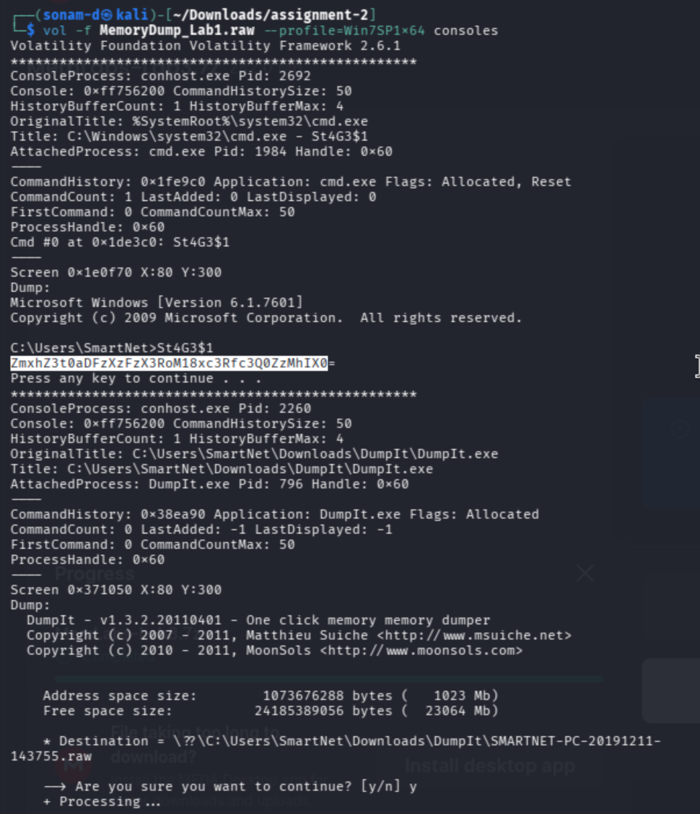

figure 1: cmdscan output 

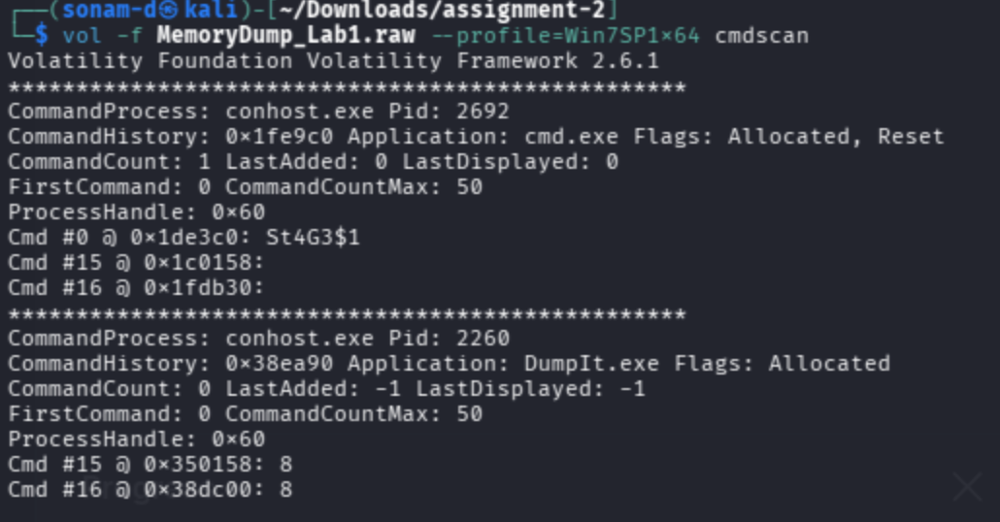

figure 2: consoles history output 

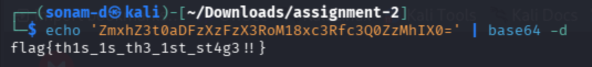

Figure 3: decoded FLAG1

### Flag 2: the RAR archive

- WinRAR had `Important.rar` open. `filescan` found it at `0x3fa3ebc0`, `0x3fac3bc0` and `0x3fb48bc0` (three file objects for the same file).
- The archive comment said the password is the NTLM hash of Alissa's account password, in uppercase. From `hashdump`, I used her NT hash converted to uppercase.
- The archive contained `flag3.png`.

**Flag: `flag{w3ll_3rd_stage_was_easy}`**

**Evidence:**

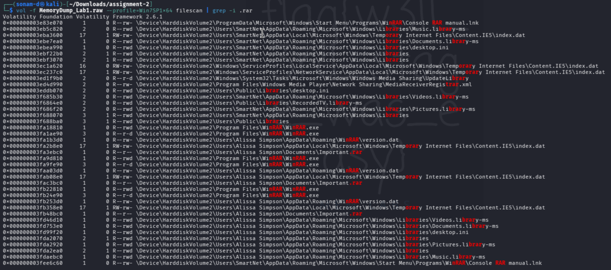

Figure 4: filescan .rar file scan

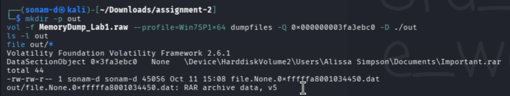

Figure 5: memory dump file

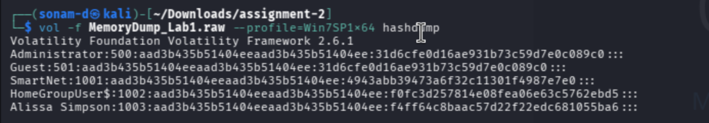

Figure 6: hashdump

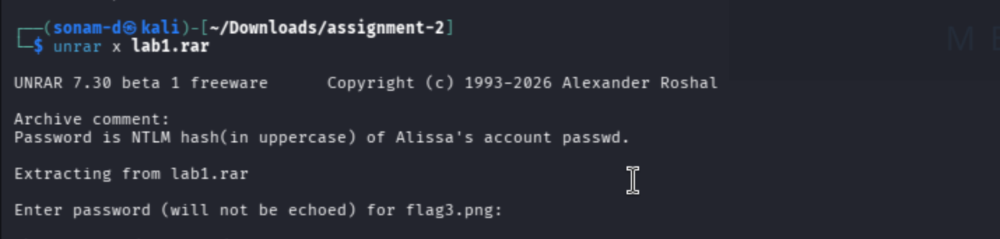

Figure 7: archive comment

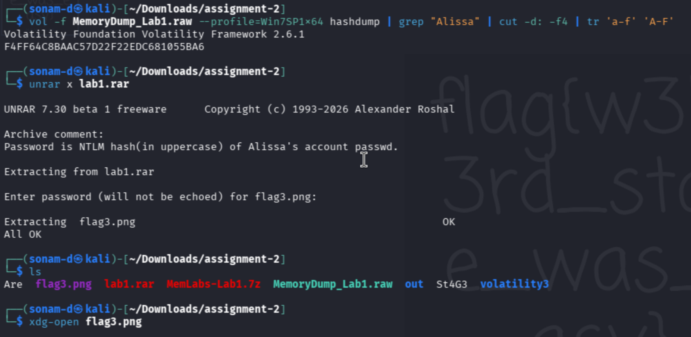

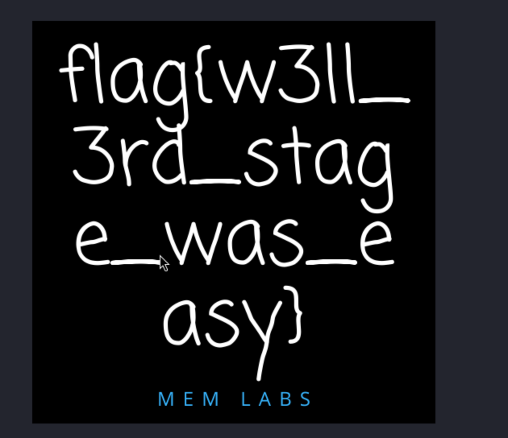

Figure 9: FLAG2

### Flag 3: the drawing in Paint

`mspaint.exe` (PID 2424) was running. Because the drawing was never saved to a file, I dumped the process memory with `memdump` and opened it in GIMP as raw image data, adjusting image type, width and offset until the picture appeared, then flipped it vertically.

**Flag: `flag{G00d_BoY_good_girl_}`**

**Evidence:** 

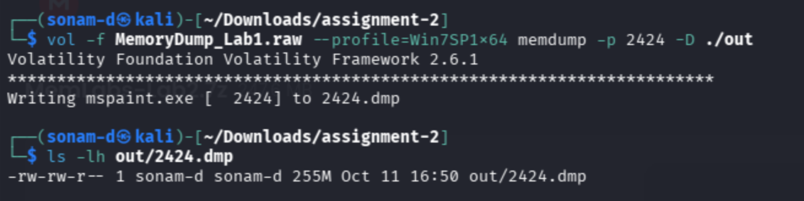

Figure 10: memdump and mspaint 

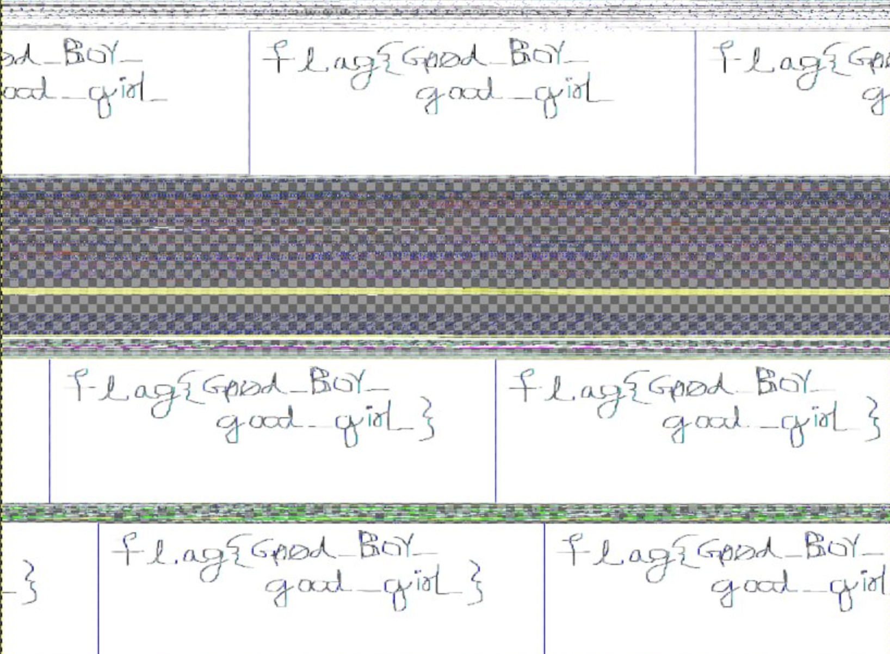

Figur 11: gimp GUI FLAG3

## 3.4 Forensic Reasoning

### Technique: [Plugin/Technique Name]

[3–5 sentences explaining why this plugin was appropriate, what type of artefact it examines, what you actually observed, and how that observation led to the next step.]

---

# 4. Lab 2

## 4.1 Scenario Summary

One of the clients of our company lost access to his system due to an unknown error. He is supposedly a very popular "environmental" activist. As a part of the investigation, he told us that his go to applications are browsers, his password managers etc. We hope that you can dig into this memory dump and find his important stuff and give it back to us.

### Memory Dump analysis

we got the profile `Win7SP1x64`  from the image info

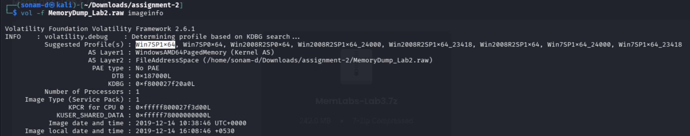

Figure 12: Process and Profile 

From the plist below the important execution file to keep in mind are `chrome.exe, notepad.exe, cmd.exe, KeePass.exe` .

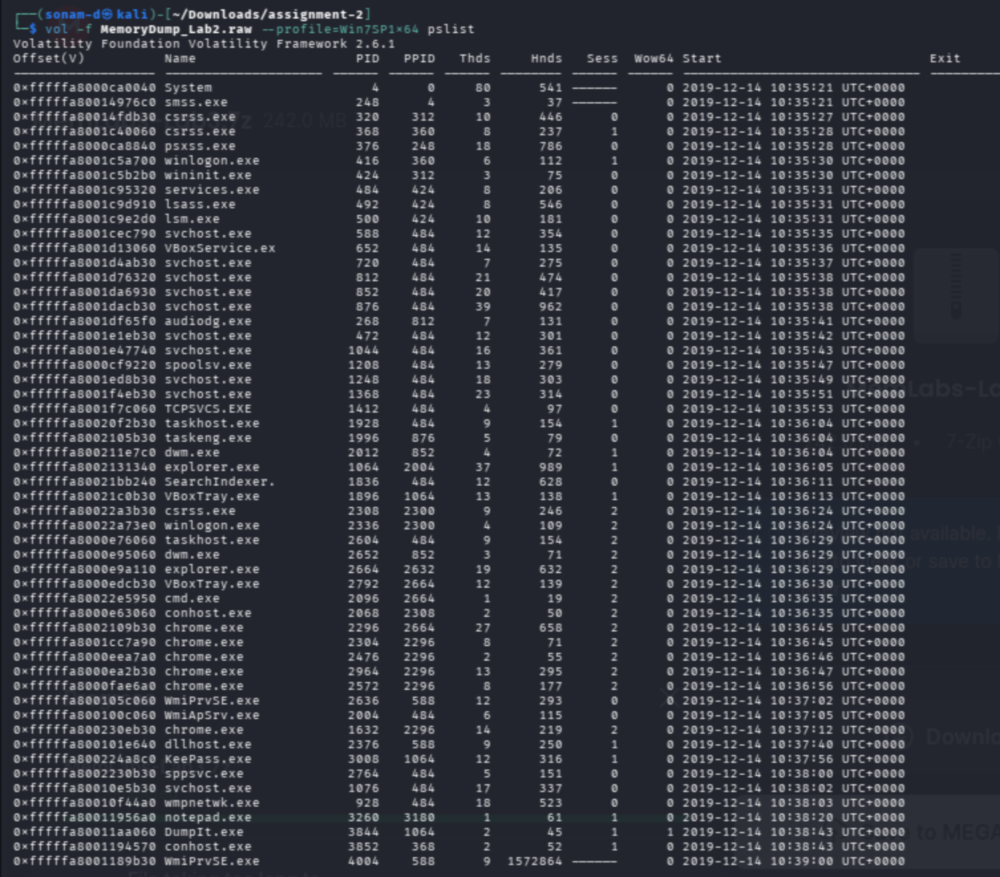

Figure 13:  Process list 

Next lets look for the command line and its history but nothing interesting was found here.


figure 14: cmdscan 


Figure 15: console 

Environmental variable scan done and here we got the following 

- A base64 encoded environmental variable named `NEW_TEP`

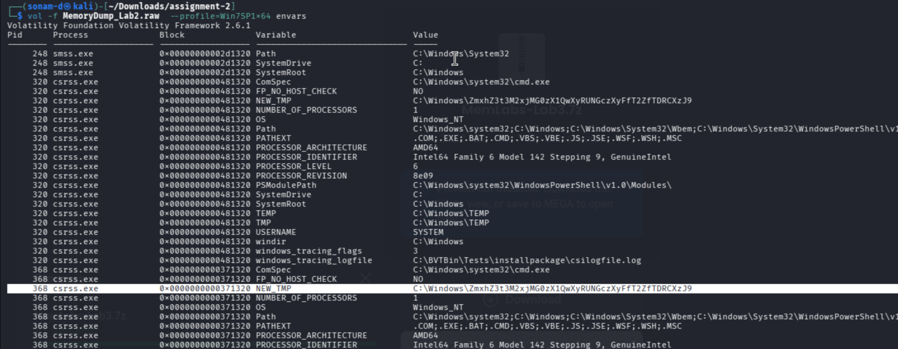

Figure 16: environmental file scan 

upon decoding the base64 “`ZmxhZ3t3M2xjMG0zX1QwXyRUNGczXyFfT2ZfTDRCXzJ9`” i got the:

**FLAG :** `flag{w3lc0m3_T0_$T4g3_!_Of_L4B_2}`


Figure 17: decoded base64 flag

while i was going through environmental scan i saw the `keepees.exe` file with the same base64 coding


Figure 18:  keepees file from environmental scan 

after some googling  i came to know that keepees is some kind of storage where it stores the data in `.kdbx`  file extention.


Figure 19: file scan to find a .kdbx file 

since we have the keepassx tool lets open this file and see what we get but before let dump the in the `dump-L2` folder 


figure 20: dumping the hidden.kdbx file using its offset 

Opening the file in .kdbx  file in keepass 


Figure 21: keepass requiring a password to open the hidden.kdbx file

To find the password let me do a hashdump to see the user and there hash passwords 


Figure 22: finding the user 

we can see that Alissa from lab 1 is here. So lets do a file scan on this grep this user to see what all file they may have 

command 

```bash
vol -f MemoryDump_Lab2.raw  --profile=Win7SP1x64 filescan | grep "Alissa" 
```


Figure 23:  find the .png file using the file scan 

same as before i will again dump password.png file using it offset 


Figure 24: the password.png dumped file 

At the button of the file we can see the password as `P4SSw0rd_123`  and i used this password in the keepass 


Figure 25: inserting the password in keepass


Figure 26: getting the flag from the recycle bin

I got through the keepass password and under the `Recycle Bin/Sabka Baap` I got the Flag 

**FLAG: `flag{w0w_th1s_1s_Th3_SeC0nD_ST4g3_!!}`** 

### Browser history

Keep in mind i had also saw a chrome.exe file so lets check the browsing history and for this we will use chrome history plugin for this 


Figure 27: chrome history 

index 32 url caught my eye as it so i pasted this url in the browser 


so i Downloaded the zip file and tried to unzip the file but it need a password for it but i remember that in lab 1 there was a hint saying “Password is SHA1(stage-3-FLAG) from Lab-1. Password is in lowercase.” 


Figure 28: zip file needing password 

Remembering this i did the following 


Figure 29: SHA1 for the flag from lab 1 

And after getting the password i used it to get unzip the file and got the flag 

FLAG: `flag{ok_So_Now_St4g3_3_is_DoNE!!}`


Figure 30: flag 

---

# 5. Lab 3: **The Evil's Den**

## 5.1 Scenario Summary

A malicious script encrypted a very secret piece of information I had on my system. Can you recover the information for me please?

## Memory Dump Analysis

### Profile and Process analysis

starting off with the image info scan 


Figure 31: imageinfo scan 

Next we are going to scan the process and we can see `notepad.exe` being done indicating something was wrote and executed


Figure 32: plist output 

lets do a command line scan and see what we get know there. 

command used

```bash
vol -f MemoryDump_Lab3.raw --profile=Win7SP1x86_23418  cmdline
```

And as expected a `evilscript.py` was ran and executed with a `vip.txt`  also being written


figure 33: cmdline output showing which all command were ran 

Searching for the two file and importantly there offset 


figure 34: filescan output

Now that we got the offset for the two  file we will dump the file and see what each file contain 


figure 32: dump files 

Here is what the .py and .txt file contained


figure 33: reading the dumpfiles 

So from the python file we can see that the string was encoding was two step process, First the string is being XORed with the value 3 and the resulting XORed string was than encoded using base64 and written to the `vip.txt` file. 

So my approach to this was in reverse order first that is first i will decode it using base64 and XOR it with the resulting base64 to find the string.

using i did the following 


figure 34: decoding the half flag 

**Half part of the FLAG:  `inctf{0n3_h4lf`** 

### **Investigating Steganographicallyfile**

In the challenge scenario we can see that it was hinting to use steghide which is usually used in image analysis. But during the plist scan i did not saw any file related to a image so lets verifu that and see what we get 

So i get a `suspision1.png` image file from the scan 


figure 35:  file scan for image files

ok so i dumped this image file  to see what i could get from it 


figure 36: dumping image file 

So i tried to open the image file but it needed a passphrase to open it. but i remembered that the in the challenge description it said the first half of the flag is need to get the second flag so i used the first half of the flag to unlock it and got  the following


figure 37: inside the image file 

From the `steghide` info output, we got the information that there is a ‘secret text’ file now lets extract the file.


figure 37: second half of the flag

So as mentioned by the hint we go the second half of the flag 

**FLAG: `inctf{0n3_h4lf_1s_n0t_3n0ugh}`** 

---

# 6. Lab 4

## 6.1 Scenario Summary

My system was recently compromised. The Hacker stole a lot of information but he also deleted a very important file of mine. I have no idea on how to recover it. The only evidence we have, at this point of time, is this memory dump. Please help me.

## Memory Dump analysis

#### Profile and Process Scan

As always lets start with a image info scan to start everything 


figure 38: imageinfo scan 

Next we will do process listing and found the following 


figure 39: pslist scan output

I saw a `StikyNot.exe`  file that so i dumped it using the it and looked for what was in it 


figure 40: memory dumped file 

Lets see what all are there in this file 

command used

```bash
strings ./dumps/2432.dmp | less
```


figure 41: strings output

In the challenge description it says it says that the attacker has delete the important file and keep that in mind let’s do a file scan and see what i will be getting from it 

command used 

```bash
vol -f MemoryDump_Lab4.raw --profile Win7SP1x64 filescan 
```


figure 42: file scan output 

After this i dumped this two file but its didnt contain anything interesting and so i moved on and went back to see what was more in the file scan output. And i remembered there was another user in my earlier scan named “Slimshady”  and i did a file scan on that user and found a `impportant.txt`  file on that user. 

So i dumped that file and it had a offset of `0x000000003fc398d0` .


figure 43: dumpfile not dumped 

but the dump file didnt come here. The reason was that the file had been deleted by the attacker and the dumpfile didnt work.

So i checked the recycle bin for this 

I did some research about how to analyze and got the following 

**NOTE**

- The NTFS file system contains a file called the master file table, or MFT. There is at least one entry in the MFT for every file on an NTFS file system volume. All information about a file, including its name, size, time and date stamps, permissions, and data content, is stored either in MFT entries, or in space outside the MFT that is described by MFT entries.
- As files are added to an NTFS file system volume, more entries are added to the MFT and the MFT increases in size. When files are deleted from an NTFS file system volume, their MFT entries are marked as free and may be reused. However, disk space that has been allocated for these entries is not reallocated, and the size of the MFT does not decrease.
- A file whose size is less than or equal to 1024 bytes will be stored directly in the MFT table (named “resident” file), if it exceeds 1024 bytes the table will only contain the information of its location (named “non-resident” file).

So let’s search for `Important.txt` in the MFT table.

command used 

```bash
vol -f MemoryDump_Lab4.raw --profile Win7SP1x64 mftparser > mft.txt
```


figure 44: flag obtained

**FLAG: `*inctf{1_is_n0t_EQu4l_7o_2_bUt_th1s_d0s3nt_m4ke_s3ns3}*`**

---

# 7. Lab 5: **Black Tuesday**

## 7.1 Scenario Summary

We received this memory dump from our client recently. Someone accessed his system when he was not there and he found some rather strange files being accessed. Find those files and they might be useful. I quote his exact statement,

*“The names were not readable. They were composed of alphabets and numbers but I wasn't able to make out what exactly it was.”*

Also, he noticed his most loved application that he always used crashed every time he ran it. Was it a virus?

### **Memory dump analysis**

#### Profile and Process Analysis


figure 45: image info output 


figure 46: plist output 

the plist output showed noticing output file such as `WinRAR.exe, NOTEPAD.EXE, explorer.exe` 

let check the cmdline after that with command 

```bash
vol -f MemoryDump_Lab5.raw --profile=Win7SP1x64 cmdline 
```


figure 47: cmdline output 

from the cmdline output we found the path to the `NOTEPAD` file and we can see that I got the name of the **RAR** file and one more interesting thing is that ***NOTEPAD*** is running from the Videos folder.


figure 48: dumpfile output

#### Browser histroy analysis

So I dumped the .rar file and and when i tried to open it there as a password that needed it to open it. I was lose for a while but i remember there was a there a also a browser that we running at that time. So i used the check the browser history using the command 

```bash
vol -f MemoryDump_Lab5.raw --profile=Win7SP1x64 iehistory
```


figure 49: browser history output 

this is interesting usually the browser history would be descriptive but in this case the it is long and unusually and also base64 encoded

i tried decoding the url enpoint since it was encoded 


figure 50: endpoint decoded

ok so surprisingly the url was one of the flags 

**FLAG: `flag{!!_w3LL_d0n3_St4g3-1_0f_L4B_5_D0n3_!!}`** 

And also the decoded flag was the password to unrar the file 


figure 51: unrar the file 


Figure 52: flag 2 

OK!! 2 flag down and one more to go. After this i still need to check the `NOTEPAD.exe`  file maybe the last flag is hiding there.


figure 53: dumped the notepad.exe

ok so the dumped file in there gave me a .dat file. It is a PE32 executable file for MS Windows.

I just pasted the dumped PE32 file into IDA for some static analysis. IDA (Interactive Disassembler) is a premier software tool used to perform reverse engineering of malware binaries.
I found something peculiar about the program, it was manually pushing single hex bytes to the stack to form a string, character by character.
I reconstructed the characters from the hex values in order and it spelled out the final secret that is “`bi0s{M3m_l4B5_OVeR_!}`”


figure 54: IDA output

**FLAG:** `bi0s{M3m_l4B5_OVeR_!}` 

---

# 8. Conclusion

The MemLabs exercises showed me that memory forensics usually requires several investigative steps rather than relying on a single Volatility command. Different plugins reveal different types of evidence, so the output of one plugin often provides information needed for the next stage of the investigation.

The labs also demonstrated the importance of keeping an investigation log. Some commands may not immediately reveal useful evidence, but they still help eliminate possibilities and guide the investigation towards more appropriate techniques.

Another important lesson was that evidence from different stages can be connected. For example, information or a flag recovered in one lab may be required to understand or continue another lab. This shows why forensic investigators must preserve results carefully and understand the relationship between separate artefacts.

A limitation of the investigation was the additional setup required to run the older Volatility 2 framework on a modern ARM64 Kali Linux environment. Problems such as disk space, package availability, Python 2 dependencies, and community-plugin compatibility had to be solved before the actual forensic work could begin. However, resolving these problems also helped me understand the practical difficulties that can occur when working with older forensic tools.

Overall, the assignment improved my understanding of how volatile memory can contain important evidence that may not be available from normal file-system analysis. It also improved my ability to select forensic plugins based on the type of evidence I was looking for rather than running tools without a clear purpose.